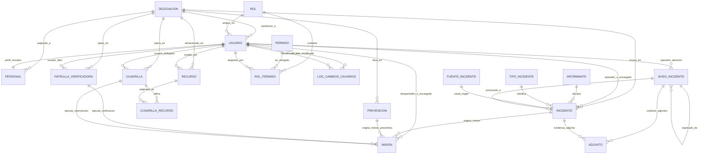

# Documentación del Modelo de Datos y Base de Datos (SGRAI-API)

Este documento es la **fuente de verdad técnica y arquitectónica** de la base de datos relacional del Sistema de Gestión de Recursos para Atención de Incidentes (**SGRAI**), Dirección de Gestión de Riesgos de Desastres de la Ilustre Municipalidad de Valdivia.

> [!NOTE]
> **Para Asistentes de IA y Desarrolladores:**
> Toda consulta, migración, repositorio o servicio que interactúe con la base de datos debe adherirse estrictamente a las convenciones, nombres de tablas, columnas, tipos de datos, claves foráneas y enumerados documentados aquí.

---

## 1. Arquitectura y Stack de Persistencia

- **Motor de Base de Datos:** PostgreSQL 16 con extensión espacial **PostGIS 3.4** (EPSG:4326 WGS 84).
- **Capa de Acceso a Datos (DAL):** **Kysely** (Query Builder con tipado estricto en TypeScript). **No se utiliza ORM** (evitar Prisma, TypeORM, etc.).
- **Convenciones de Nombres:**
  - **Tablas:** Nombres canónicos en **minúsculas, singular y snake_case** (ej. `incidente`, `aviso_incidente`, `usuario`, `recurso`, `mision`).
  - **Vistas de compatibilidad:** Existen vistas en plural (`usuarios`, `roles`, `permisos`, `incidentes`, etc.) creadas por retrocompatibilidad con queries legadas, pero **el código nuevo debe consultar las tablas canónicas en singular**.
  - **Columnas:** En `snake_case` (ej. `tipo_afectacion`, `direccion_texto`, `creado_en`, `codigo_seguimiento`).
  - **Identificadores (PK):** UUID v4 generados automáticamente mediante `gen_random_uuid()`.
  - **Campos temporales:** `creado_en` y `actualizado_en` de tipo `TIMESTAMPTZ` con valor por defecto `CURRENT_TIMESTAMP`.
  - **Campos geoespaciales:** Columnas escalares `latitud` y `longitud` (tipo `NUMERIC(10, 7)`), acompañadas por la columna espacial `ubicacion` de tipo `GEOMETRY(Point, 4326)` e indexadas mediante índices espaciales **GiST**.

---

## 2. Diagrama Entidad-Relación (Mermaid)



---

## 3. Módulos de Dominio y Diccionario de Datos

### 3.1 Módulo: Seguridad y Organización

#### Tabla: `rol`
Almacena los roles del sistema de control de acceso basado en roles (RBAC).

| Columna | Tipo | Nulo | Por Defecto | Descripción |
|---|---|---|---|---|
| `id` | `UUID` | NO | `gen_random_uuid()` | Identificador único del rol. |
| `codigo` | `VARCHAR(50)` | NO | — | Clave única del rol (ej. `ADMIN`, `CALL_CENTER`, `ENCARGADO`). Unique. |
| `nombre` | `VARCHAR(100)` | NO | — | Nombre legible (ej. `Administrador`, `Call Center`). Unique. |
| `descripcion` | `TEXT` | SÍ | `NULL` | Detalle de responsabilidades del rol. |
| `activo` | `BOOLEAN` | NO | `true` | Estado activo/inactivo. |
| `es_sistema` | `BOOLEAN` | NO | `false` | Indica si es un rol inmutable de fábrica del sistema. |
| `creado_en` | `TIMESTAMPTZ` | NO | `CURRENT_TIMESTAMP` | Fecha de creación. |
| `actualizado_en`| `TIMESTAMPTZ` | NO | `CURRENT_TIMESTAMP` | Fecha de última modificación. |

#### Tabla: `permiso`
Define las facultades granulares asignables a roles.

| Columna | Tipo | Nulo | Por Defecto | Descripción |
|---|---|---|---|---|
| `id` | `UUID` | NO | `gen_random_uuid()` | Identificador único del permiso. |
| `codigo` | `VARCHAR(50)` | NO | — | Código canónico del permiso (ej. `incidentes:kanban`, `recursos:leer`). Unique. |
| `nombre` | `VARCHAR(100)` | NO | — | Nombre descriptivo del permiso. |
| `descripcion` | `TEXT` | SÍ | `NULL` | Explicación de la acción permitida. |
| `modulo` | `VARCHAR(50)` | NO | — | Módulo al que pertenece (`Seguridad`, `Incidentes`, `Misiones`, `Recursos y Personal`). |
| `creado_en` | `TIMESTAMPTZ` | NO | `CURRENT_TIMESTAMP` | Fecha de registro. |

#### Tabla: `rol_permiso`
Pivote N:M entre roles y permisos.

| Columna | Tipo | Nulo | Por Defecto | Descripción / Relación |
|---|---|---|---|---|
| `rol_id` | `UUID` | NO | — | FK a `rol.id` (ON DELETE CASCADE). |
| `permiso_id` | `UUID` | NO | — | FK a `permiso.id` (ON DELETE CASCADE). |
| `asignado_por_id`| `UUID` | SÍ | `NULL` | FK a `usuario.id` que otorgó el permiso. |
| `asignado_en` | `TIMESTAMPTZ` | NO | `CURRENT_TIMESTAMP` | Momento de asignación. |
| **PK** | `(rol_id, permiso_id)` | | | Llave primaria compuesta. |

#### Tabla: `delegacion`
Representa las cuatro delegaciones territoriales de la Municipalidad de Valdivia.

| Columna | Tipo | Nulo | Por Defecto | Descripción |
|---|---|---|---|---|
| `id` | `UUID` | NO | `gen_random_uuid()` | Identificador único de la delegación. |
| `codigo` | `VARCHAR(50)` | NO | — | Código canónico (`DEL_NORTE`, `DEL_SUR`, `DEL_COSTA`, `DEL_CALLE_CALLE`). Unique. |
| `nombre` | `VARCHAR(100)` | NO | — | Nombre institucional oficial. Unique. |
| `direccion` | `TEXT` | SÍ | `NULL` | Dirección física de la sede. |
| `descripcion` | `TEXT` | SÍ | `NULL` | Sectores o cuadrantes que abarca. |
| `activo` | `BOOLEAN` | NO | `true` | Estado operativo de la delegación. |
| `creado_en` | `TIMESTAMPTZ` | NO | `CURRENT_TIMESTAMP` | Fecha de creación. |
| `actualizado_en`| `TIMESTAMPTZ` | NO | `CURRENT_TIMESTAMP` | Fecha de última modificación. |

#### Tabla: `usuario`
Cuentas de usuario de funcionarios y operadores municipales.

| Columna | Tipo | Nulo | Por Defecto | Descripción / Relación |
|---|---|---|---|---|
| `id` | `UUID` | NO | `gen_random_uuid()` | Identificador único del usuario. |
| `rut` | `VARCHAR(20)` | NO | — | Identificador fiscal chileno (RUT con guion y DV). Unique. |
| `nombres` | `VARCHAR(100)` | NO | — | Nombres de pila. |
| `apellidos` | `VARCHAR(100)` | NO | — | Apellidos paterno y materno. |
| `nombre` | `VARCHAR(255)` | SÍ | `NULL` | Nombre completo consolidado. |
| `email` | `VARCHAR(150)` | NO | — | Correo electrónico corporativo. Unique. |
| `telefono` | `VARCHAR(50)` | SÍ | `NULL` | Teléfono de contacto institucional o móvil. |
| `password_hash`| `VARCHAR(255)` | NO | `$2b$10$...` | Hash bcrypt de la contraseña. |
| `rol_id` | `UUID` | NO | — | FK a `rol.id` (ON DELETE RESTRICT). |
| `delegacion_id`| `UUID` | SÍ | `NULL` | FK a `delegacion.id` (ON DELETE SET NULL). |
| `activo` | `BOOLEAN` | NO | `true` | Habilitación de acceso al sistema. |
| `ultimo_acceso`| `TIMESTAMPTZ` | SÍ | `NULL` | Fecha y hora del último login. |
| `fecha_ingreso`| `DATE` | SÍ | `NULL` | Fecha de inicio de funciones. |
| `fecha_salida` | `DATE` | SÍ | `NULL` | Fecha de desvinculación o cese de funciones. |
| `creado_en` | `TIMESTAMPTZ` | NO | `CURRENT_TIMESTAMP` | Fecha de registro. |
| `actualizado_en`| `TIMESTAMPTZ` | NO | `CURRENT_TIMESTAMP` | Fecha de última actualización. |

#### Tabla: `personal`
Ficha técnica operativa del personal de terreno (vinculada 1:1 al usuario).

| Columna | Tipo | Nulo | Por Defecto | Descripción / Relación |
|---|---|---|---|---|
| `id` | `UUID` | NO | `gen_random_uuid()` | Identificador de la ficha de personal. |
| `usuario_id` | `UUID` | NO | — | FK a `usuario.id` (ON DELETE CASCADE). Unique 1:1. |
| `delegacion_id`| `UUID` | NO | — | FK a `delegacion.id` (ON DELETE RESTRICT). |
| `especialidad` | `VARCHAR(100)`| SÍ | `NULL` | Oficio/especialidad (motosierrista, electricista, etc.). |
| `cargo` | `VARCHAR(100)`| SÍ | `NULL` | Cargo funcional en la cuadrilla o delegación. |
| `estado_operativo`| `VARCHAR(50)`| NO | `'disponible'` | Estado (`disponible`, `en_mision`, `en_patrulla`, `descanso`, `licencia`, `inactivo`). |
| `disponible_terreno`| `BOOLEAN`| NO | `true` | Aptitud médica/técnica para salir a emergencias. |
| `ultima_ubicacion` | `TEXT` | SÍ | `NULL` | Última referencia geográfica reportada. |
| `ultima_actualizacion_ubicacion`| `TIMESTAMPTZ` | SÍ | `NULL` | Timestamp del último reporte GPS. |
| `observaciones`| `TEXT` | SÍ | `NULL` | Notas operativas o de salud ocupacional. |
| `created_at` | `TIMESTAMPTZ` | NO | `CURRENT_TIMESTAMP` | Fecha de creación. |
| `updated_at` | `TIMESTAMPTZ` | NO | `CURRENT_TIMESTAMP` | Fecha de modificación. |

#### Tabla: `log_cambios_usuarios`
Auditoría estricta de cambios sobre las cuentas de usuario.

| Columna | Tipo | Nulo | Por Defecto | Descripción / Relación |
|---|---|---|---|---|
| `id` | `UUID` | NO | `gen_random_uuid()` | Identificador de la traza de auditoría. |
| `usuario_modificado_id` | `UUID` | NO | — | FK a `usuario.id` modificado (ON DELETE CASCADE). |
| `modificado_por_id` | `UUID` | SÍ | `NULL` | FK a `usuario.id` que ejecutó la modificación. |
| `campos_modificados` | `TEXT` | NO | — | Resumen o payload serializado de las diferencias. |
| `created_at` | `TIMESTAMPTZ` | NO | `CURRENT_TIMESTAMP` | Momento exacto del cambio. |

---

### 3.2 Módulo: Incidentes, Avisos y Evidencia

#### Tabla: `informante`
Registro de ciudadanos que notifican situaciones de emergencia.

| Columna | Tipo | Nulo | Por Defecto | Descripción |
|---|---|---|---|---|
| `id` | `UUID` | NO | `gen_random_uuid()` | Identificador único del informante. |
| `rut` | `VARCHAR(20)` | SÍ | `NULL` | RUT del informante si fue proporcionado. |
| `nombre` | `VARCHAR(150)`| SÍ | `NULL` | Nombre de pila o contacto. |
| `telefono` | `VARCHAR(50)` | SÍ | `NULL` | Teléfono para retorno de llamadas o WhatsApp. |
| `creado_en` | `TIMESTAMPTZ` | NO | `CURRENT_TIMESTAMP` | Fecha de primer registro. |

#### Tabla: `tipo_incidente`
Catálogo estandarizado de tipologías de emergencia municipal.

| Columna | Tipo | Nulo | Por Defecto | Descripción |
|---|---|---|---|---|
| `id` | `UUID` | NO | `gen_random_uuid()` | Identificador único del tipo de incidente. |
| `nombre` | `VARCHAR(100)`| NO | — | Nombre oficial (ej. `Anegamiento`, `Caída de árbol`, `Inundación`, `Deslizamiento`). Unique. |
| `descripcion` | `TEXT` | SÍ | `NULL` | Protocolo breve de atención o alcance. |
| `activo` | `BOOLEAN` | NO | `true` | Habilitación en listas desplegables. |
| `creado_en` | `TIMESTAMPTZ` | NO | `CURRENT_TIMESTAMP` | Fecha de registro. |

#### Tabla: `fuente_incidente`
Canal de ingreso del reporte.

| Columna | Tipo | Nulo | Por Defecto | Descripción |
|---|---|---|---|---|
| `id` | `UUID` | NO | `gen_random_uuid()` | Identificador del canal. |
| `nombre` | `VARCHAR(50)` | NO | — | Canal canónico (`CHATBOT`, `LLAMADA_TELEFONICA`, `FUNCIONARIO_TERRENO`, `SENAPRED`). Unique. |
| `descripcion` | `TEXT` | SÍ | `NULL` | Notas de integración del canal. |
| `creado_en` | `TIMESTAMPTZ` | NO | `CURRENT_TIMESTAMP` | Fecha de creación. |

#### Tabla: `aviso_incidente`
Bandeja de entrada de reportes ciudadanos antes de ser clasificados formalmente por el Call Center.

| Columna | Tipo | Nulo | Por Defecto | Descripción / Relación |
|---|---|---|---|---|
| `id` | `UUID` | NO | `gen_random_uuid()` | Identificador único del aviso. |
| `codigo_seguimiento` | `VARCHAR(50)` | NO | — | Código numérico de 8 dígitos entregado al informante. |
| `tipo_afectacion` | `VARCHAR(100)`| NO | — | Tipología descrita en el reporte inicial. |
| `descripcion` | `TEXT` | SÍ | `NULL` | Relato ciudadano de la situación. |
| `direccion_texto` | `TEXT` | NO | — | Dirección o punto de referencia en Valdivia. |
| `latitud` | `NUMERIC(10, 7)`| NO | — | Coordenada Y (WGS 84). |
| `longitud` | `NUMERIC(10, 7)`| NO | — | Coordenada X (WGS 84). |
| `ubicacion` | `GEOMETRY` | SÍ | — | Geometría PostGIS `Point(lng, lat)`. |
| `informante_nombre`| `VARCHAR(150)`| NO | — | Nombre del informante. |
| `informante_rut` | `VARCHAR(20)` | NO | — | RUT del informante. |
| `informante_telefono`| `VARCHAR(50)`| SÍ | `NULL` | Teléfono de contacto. |
| `origen_reporte` | `VARCHAR(50)` | NO | `'CHATBOT'` | Canal de origen (`WEB`, `CHATBOT`, `TELEFONO`). |
| `estado` | `VARCHAR(50)` | NO | `'PENDIENTE_VERIFICACION'` | Estado del aviso (`PENDIENTE_VERIFICACION`, `NO_VERIFICADO`, `VERIFICADO`, `DESCARTADO`). |
| `es_duplicado` | `BOOLEAN` | NO | `false` | Indica si coincide espacial/temporalmente con otro reporte. |
| `aviso_original_id`| `UUID` | SÍ | `NULL` | FK autorreferencial a `aviso_incidente.id` en caso de duplicidad. |
| `motivo_descarte` | `TEXT` | SÍ | `NULL` | Justificación obligatoria si el operador descarta el aviso. |
| `operador_id` | `UUID` | SÍ | `NULL` | FK a `usuario.id` (Operador que verificó o descartó). |
| `incidente_id` | `UUID` | SÍ | `NULL` | FK a `incidente.id` formal generado tras verificación. |
| `creado_en` | `TIMESTAMPTZ` | NO | `CURRENT_TIMESTAMP` | Momento de ingreso del reporte. |
| `actualizado_en`| `TIMESTAMPTZ` | NO | `CURRENT_TIMESTAMP` | Momento de última gestión. |

#### Tabla: `incidente`
Registro formal de incidente de emergencia gestionado bajo la metodología del Sistema de Comando de Incidentes (**ICS**).

| Columna | Tipo | Nulo | Por Defecto | Descripción / Relación |
|---|---|---|---|---|
| `id` | `UUID` | NO | `gen_random_uuid()` | Identificador único del incidente formal. |
| `codigo` | `VARCHAR(50)` | SÍ | — | Código oficial de incidente (ej. `INC-2026-8869`). Unique. |
| `folio` | `VARCHAR(50)` | SÍ | — | Folio único institucional correlativo. Unique. |
| `codigo_seguimiento` | `VARCHAR(50)` | SÍ | — | Código de 8 dígitos para seguimiento público ciudadano. |
| `informante_id` | `UUID` | SÍ | `NULL` | FK a `informante.id` (ON DELETE SET NULL). |
| `tipo_incidente_id` | `UUID` | SÍ | `NULL` | FK a `tipo_incidente.id` (ON DELETE SET NULL). |
| `aviso_id` | `UUID` | SÍ | `NULL` | FK a `aviso_incidente.id` de origen (ON DELETE SET NULL). |
| `delegacion_id` | `UUID` | SÍ | `NULL` | FK a `delegacion.id` territorial (ON DELETE SET NULL). |
| `fuente_incidente_id`| `UUID` | SÍ | `NULL` | FK a `fuente_incidente.id` (ON DELETE SET NULL). |
| `tipo_afectacion` | `VARCHAR(100)`| SÍ | — | Categoría textual de la afectación principal. |
| `descripcion` | `TEXT` | SÍ | `NULL` | Descripción operativa y técnica del incidente. |
| `direccion_texto` | `TEXT` | SÍ | — | Dirección estandarizada en la comuna. |
| `latitud` | `NUMERIC(10, 7)`| NO | — | Coordenada Y (latitud). |
| `longitud` | `NUMERIC(10, 7)`| NO | — | Coordenada X (longitud). |
| `ubicacion` | `GEOMETRY` | NO | — | Geometría PostGIS `Point(lng, lat)`, SRID 4326. Indexada con GiST. |
| `estado` | `VARCHAR(50)` | NO | `'REPORTADO'` | Estado canónico ICS (`REPORTADO`, `VERIFICANDO`, `EN_ATENCION`, `NO_ABORDABLE`, `RESUELTO`). |
| `prioridad` | `VARCHAR(20)` | NO | `'MEDIA'` | Severidad ICS (`BAJA`, `MEDIA`, `ALTA`, `CRITICA`). |
| `requiere_asistencia_social`| `BOOLEAN` | NO | `false` | Indica si requiere derivación a DIDECO para Ficha FIBE. |
| `fuente_origen` | `VARCHAR(50)` | NO | `'CHATBOT'` | Canal original (`CHATBOT`, `LLAMADA_TELEFONICA`, `FUNCIONARIO_TERRENO`, `SENAPRED`). |
| `asterisk_call_id`| `VARCHAR(100)`| SÍ | `NULL` | Identificador de llamada telefónica IVR si aplica. |
| `asterisk_caller_phone`| `VARCHAR(30)`| SÍ | `NULL` | Número de teléfono entrante de la llamada IVR. |
| `creado_por_id` | `UUID` | SÍ | `NULL` | FK a `usuario.id` que creó o registró el caso. |
| `operador_id` | `UUID` | SÍ | `NULL` | FK a `usuario.id` operador responsable. |
| `encargado_id` | `UUID` | SÍ | `NULL` | FK a `usuario.id` encargado de operaciones asignado. |
| `creado_en` | `TIMESTAMPTZ` | NO | `CURRENT_TIMESTAMP` | Fecha de creación. |
| `actualizado_en`| `TIMESTAMPTZ` | NO | `CURRENT_TIMESTAMP` | Fecha de última actualización. |

#### Tabla: `adjunto`
Evidencia digital (fotos, audios, documentos) vinculada a avisos o incidentes.

| Columna | Tipo | Nulo | Por Defecto | Descripción / Relación |
|---|---|---|---|---|
| `id` | `UUID` | NO | `gen_random_uuid()` | Identificador del archivo adjunto. |
| `nombre_archivo`| `VARCHAR(255)`| NO | — | Nombre original del archivo en el cliente. |
| `url` | `TEXT` | NO | — | URL o ruta de almacenamiento del objeto/archivo. |
| `tipo_mime` | `VARCHAR(100)`| NO | — | Formato MIME (ej. `image/jpeg`, `audio/ogg`, `application/pdf`). |
| `tamano_bytes` | `BIGINT` | NO | — | Peso del archivo en bytes. |
| `aviso_id` | `UUID` | SÍ | `NULL` | FK a `aviso_incidente.id` (ON DELETE CASCADE). |
| `incidente_id` | `UUID` | SÍ | `NULL` | FK a `incidente.id` (ON DELETE SET NULL). |
| `creado_en` | `TIMESTAMPTZ` | NO | `CURRENT_TIMESTAMP` | Fecha de subida. |

---

### 3.3 Módulo: Operaciones, Logística y Terreno

#### Tabla: `recurso`
Inventario de equipamiento, vehículos y maquinaria disponible para emergencias.

| Columna | Tipo | Nulo | Por Defecto | Descripción / Relación |
|---|---|---|---|---|
| `id` | `UUID` | NO | `gen_random_uuid()` | Identificador del recurso logístico. |
| `nombre` | `VARCHAR(255)`| NO | — | Nombre del recurso (ej. `Motobomba 4 pulgadas`, `Camioneta 4x4`). |
| `es_individual` | `BOOLEAN` | NO | `false` | `true` si es maquinaria con patente/número de serie; `false` si es a granel. |
| `estado` | `VARCHAR(50)` | NO | `'DISPONIBLE'` | Estado (`DISPONIBLE`, `ASIGNADO`, `EN_MANTENCION`, `BAJO_STOCK`, `NO_DISPONIBLE`). |
| `cantidad_inventario`| `INTEGER` | NO | — | Stock total inventariado. |
| `cantidad_en_uso`| `INTEGER` | NO | `0` | Cantidad actualmente despachada en misiones. |
| `cantidad_minima`| `INTEGER` | NO | `0` | Umbral para alerta de bajo stock. |
| `latitud` | `NUMERIC(10, 7)`| NO | — | Coordenada Y de su base/almacén. |
| `longitud` | `NUMERIC(10, 7)`| NO | — | Coordenada X de su base/almacén. |
| `ubicacion` | `GEOMETRY` | SÍ | — | Geometría PostGIS del almacén o base. |
| `descripcion` | `TEXT` | SÍ | `NULL` | Especificaciones técnicas o marca/modelo. |
| `detalles` | `JSONB` | NO | `'{}'` | Metadatos adicionales (número de serie, ficha de mantención). |
| `delegacion_id` | `UUID` | SÍ | `NULL` | FK a `delegacion.id` donde se almacena el recurso. |
| `creado_por_id` | `UUID` | NO | — | FK a `usuario.id` responsable del inventario. |
| `creado_en` | `TIMESTAMPTZ` | NO | `CURRENT_TIMESTAMP` | Fecha de alta en inventario. |
| `actualizado_en`| `TIMESTAMPTZ` | NO | `CURRENT_TIMESTAMP` | Fecha de actualización. |

#### Tabla: `patrulla_verificadora`
Unidades tácticas ligeras de terreno destinadas a la verificación primaria del incidente.

| Columna | Tipo | Nulo | Por Defecto | Descripción / Relación |
|---|---|---|---|---|
| `id` | `UUID` | NO | `gen_random_uuid()` | Identificador de la patrulla verificadora. |
| `nombre` | `VARCHAR(100)`| NO | — | Nombre identificador (ej. `Patrulla Alfa 1`). |
| `estado` | `VARCHAR(50)` | NO | `'DISPONIBLE'` | Estado operativo (`DISPONIBLE`, `EN_VERIFICACION`, `NO_DISPONIBLE`). |
| `delegacion_id` | `UUID` | SÍ | `NULL` | FK a `delegacion.id` base. |
| `usuario_lider_id`| `UUID` | SÍ | `NULL` | FK a `usuario.id` líder de patrulla. |
| `creado_en` | `TIMESTAMPTZ` | NO | `CURRENT_TIMESTAMP` | Fecha de conformación. |

#### Tabla: `cuadrilla`
Cuadrillas operativas municipales pesadas de intervención en terreno.

| Columna | Tipo | Nulo | Por Defecto | Descripción / Relación |
|---|---|---|---|---|
| `id` | `UUID` | NO | `gen_random_uuid()` | Identificador de la cuadrilla. |
| `nombre` | `VARCHAR(100)`| NO | — | Nombre de la cuadrilla (ej. `Cuadrilla Vías y Calles`). |
| `estado` | `VARCHAR(50)` | NO | `'DISPONIBLE'` | Estado operativo (`DISPONIBLE`, `EN_MISION`, `NO_DISPONIBLE`). |
| `delegacion_id` | `UUID` | SÍ | `NULL` | FK a `delegacion.id` de adscripción. |
| `usuario_delegado_id`| `UUID` | SÍ | `NULL` | FK a `usuario.id` Delegado de Cuadrilla. |
| `creado_en` | `TIMESTAMPTZ` | NO | `CURRENT_TIMESTAMP` | Fecha de registro. |

#### Tabla: `cuadrilla_recurso`
Asignación temporal de recursos a cuadrillas para ejecución de tareas.

| Columna | Tipo | Nulo | Por Defecto | Descripción / Relación |
|---|---|---|---|---|
| `id` | `UUID` | NO | `gen_random_uuid()` | Identificador de la asignación. |
| `cuadrilla_id` | `UUID` | NO | — | FK a `cuadrilla.id` (ON DELETE CASCADE). |
| `recurso_id` | `UUID` | NO | — | FK a `recurso.id` (ON DELETE RESTRICT). |
| `cantidad_asignada`| `INTEGER` | NO | `1` | Cantidad entregada a la cuadrilla. |
| `asignado_en` | `TIMESTAMPTZ` | NO | `CURRENT_TIMESTAMP` | Fecha y hora de despacho del recurso. |

#### Tabla: `prevencion`
Puntos críticos de mitigación y prevención geográfica comunal.

| Columna | Tipo | Nulo | Por Defecto | Descripción / Relación |
|---|---|---|---|---|
| `id` | `UUID` | NO | `gen_random_uuid()` | Identificador del punto crítico preventivo. |
| `codigo` | `VARCHAR(20)` | NO | — | Código del punto crítico (ej. `PREV-CALLE-01`). Unique. |
| `nombre` | `VARCHAR(150)`| NO | — | Nombre descriptivo del punto de prevención. |
| `descripcion` | `TEXT` | SÍ | `NULL` | Medidas mitigadoras a realizar periódicamente. |
| `latitud` | `NUMERIC(10, 7)`| NO | — | Coordenada Y del punto crítico. |
| `longitud` | `NUMERIC(10, 7)`| NO | — | Coordenada X del punto crítico. |
| `ubicacion` | `GEOMETRY` | SÍ | — | Geometría PostGIS Point. |
| `delegacion_id` | `UUID` | SÍ | `NULL` | FK a `delegacion.id` correspondiente. |
| `activo` | `BOOLEAN` | NO | `true` | Habilitado para misiones preventivas. |
| `creado_en` | `TIMESTAMPTZ` | NO | `CURRENT_TIMESTAMP` | Fecha de alta. |

#### Tabla: `mision`
Misiones tácticas despachadas a patrullas verificadoras o cuadrillas operativas.

| Columna | Tipo | Nulo | Por Defecto | Descripción / Relación |
|---|---|---|---|---|
| `id` | `UUID` | NO | `gen_random_uuid()` | Identificador único de la misión. |
| `codigo` | `VARCHAR(50)` | NO | — | Código oficial (ej. `MIS-2026-0001`). Unique. |
| `titulo` | `VARCHAR(150)`| NO | — | Título descriptivo de la orden operativa. |
| `descripcion` | `TEXT` | SÍ | `NULL` | Instrucciones detalladas de trabajo en terreno. |
| `tipo_mision` | `VARCHAR(50)` | NO | — | Tipo (`VERIFICACION`, `ATENCION_CUADRILLA`, `PREVENCION`, `RECUPERACION`, `ASISTENCIA_SOCIAL`). |
| `estado` | `VARCHAR(50)` | NO | `'PLANIFICADA'` | Estado (`PLANIFICADA`, `DESPACHADA`, `EN_CURSO`, `COMPLETADA`, `CANCELADA`, `RECHAZADA`). |
| `prioridad` | `VARCHAR(20)` | NO | `'MEDIA'` | Prioridad (`BAJA`, `MEDIA`, `ALTA`, `CRITICA`). |
| `justificacion_rechazo`| `TEXT`| SÍ | `NULL` | Justificación obligatoria si la cuadrilla rechaza la misión. |
| `incidente_id` | `UUID` | SÍ | `NULL` | FK a `incidente.id` (ON DELETE SET NULL). Nullable si es preventiva. |
| `prevencion_id` | `UUID` | SÍ | `NULL` | FK a `prevencion.id` (ON DELETE SET NULL). Nullable si responde a incidente. |
| `cuadrilla_id` | `UUID` | SÍ | `NULL` | FK a `cuadrilla.id` (ON DELETE SET NULL). |
| `patrulla_id` | `UUID` | SÍ | `NULL` | FK a `patrulla_verificadora.id` (ON DELETE SET NULL). |
| `encargado_id` | `UUID` | SÍ | `NULL` | FK a `usuario.id` Encargado supervisor. |
| `creado_por_id` | `UUID` | NO | — | FK a `usuario.id` que despachó la orden. |
| `fecha_inicio` | `TIMESTAMPTZ` | SÍ | `NULL` | Inicio de labores en terreno. |
| `fecha_cierre` | `TIMESTAMPTZ` | SÍ | `NULL` | Término o finalización de trabajos. |
| `creado_en` | `TIMESTAMPTZ` | NO | `CURRENT_TIMESTAMP` | Fecha de creación. |
| `actualizado_en`| `TIMESTAMPTZ` | NO | `CURRENT_TIMESTAMP` | Fecha de última actualización. |

---

## 4. Enumerados y Constantes de Dominio

| Enumerado | Valores Válidos | Ubicación en Código |
|---|---|---|
| **EstadoIncidente** | `'REPORTADO'`, `'VERIFICANDO'`, `'EN_ATENCION'`, `'NO_ABORDABLE'`, `'RESUELTO'` | `src/modules/incidentes/incidente-kanban.schema.ts` |
| **PrioridadIncidente** | `'BAJA'`, `'MEDIA'`, `'ALTA'`, `'CRITICA'` | `src/modules/incidentes/incidente-kanban.schema.ts` |
| **EstadoAviso** | `'PENDIENTE_VERIFICACION'`, `'NO_VERIFICADO'`, `'VERIFICADO'`, `'DESCARTADO'` | `src/modules/incidentes/types.ts` |
| **OrigenReporte** | `'CHATBOT'`, `'LLAMADA_TELEFONICA'`, `'FUNCIONARIO_TERRENO'`, `'WEB'`, `'TELEFONO'` | `src/lib/db/types.ts` |
| **EstadoMision** | `'PLANIFICADA'`, `'DESPACHADA'`, `'EN_CURSO'`, `'COMPLETADA'`, `'CANCELADA'`, `'RECHAZADA'` | `src/lib/db/types.ts` |
| **TipoMision** | `'VERIFICACION'`, `'ATENCION_CUADRILLA'`, `'PREVENCION'`, `'RECUPERACION'`, `'ASISTENCIA_SOCIAL'` | `src/lib/db/types.ts` |
| **EstadoRecurso** | `'DISPONIBLE'`, `'ASIGNADO'`, `'EN_MANTENCION'`, `'BAJO_STOCK'`, `'NO_DISPONIBLE'` | `src/lib/db/types.ts` |
| **EstadoPatrulla** | `'DISPONIBLE'`, `'EN_VERIFICACION'`, `'NO_DISPONIBLE'` | `src/lib/db/types.ts` |
| **EstadoCuadrilla** | `'DISPONIBLE'`, `'EN_MISION'`, `'NO_DISPONIBLE'` | `src/lib/db/types.ts` |
| **EstadoOperativoPersonal** | `'disponible'`, `'en_mision'`, `'en_patrulla'`, `'descanso'`, `'licencia'`, `'inactivo'` | `src/lib/db/types.ts` |

---

## 5. Datos Semilla Predefinidos (Seeds Oficiales)

Para mantener la integridad referencial y permitir pruebas end-to-end homogéneas entre `sgrai-api`, `sgrai-web` y `sgrai-pwa`, se han sembrado los siguientes registros canónicos:

### 5.1 Roles RBAC (`rol`)
- `20000000-0000-4000-8000-000000000001` — `ADMIN` (Administrador)
- `20000000-0000-4000-8000-000000000002` — `CALL_CENTER` (Call Center)
- `20000000-0000-4000-8000-000000000003` — `ENCARGADO` (Encargado)
- `20000000-0000-4000-8000-000000000004` — `PATRULLA_VERIFICADORA` (Patrulla Verificadora)
- `20000000-0000-4000-8000-000000000005` — `DELEGADO_CUADRILLA` (Delegado de Cuadrilla)
- `20000000-0000-4000-8000-000000000006` — `ASISTENTE_SOCIAL` (Asistente Social)
- `20000000-0000-4000-8000-000000000007` — `INFORMANTE` (Informante)
- `20000000-0000-4000-8000-000000000008` — `OBSERVADOR` (Observador Sin Permisos)
- `20000000-0000-4000-8000-000000000009` — `BRIGADISTA` (Personal de Terreno / Brigadista)
- `20000000-0000-4000-8000-000000000010` — `SUPERVISOR` (Supervisor Estratégico)

### 5.2 Usuarios Predefinidos (`usuario`)
- `00000000-0000-4000-8000-000000000001` — `admin@valdivia.cl` (Administrador General, RUT: `11111111-1`)
- `00000000-0000-4000-8000-000000000002` — `callcenter@valdivia.cl` (Operador Call Center Genérico, RUT: `22222222-2`)
- `c1111111-1111-4111-8111-111111111111` — `carlos.miranda@valdivia.cl` (Carlos Miranda - Call Center Mesa 1, RUT: `14111111-1`)
- `c2222222-2222-4222-8222-222222222222` — `patricia.valenzuela@valdivia.cl` (Patricia Valenzuela - Call Center Mesa 2, RUT: `15222222-2`)
- `a0000000-0000-4000-8000-000000000001` — `operador.qa@valdivia.cl` (Operador QA Call Center, RUT: `99999999-9`)
- `00000000-0000-4000-8000-000000000003` — `encargado@valdivia.cl` (Encargado de Operaciones Centro de Mando, RUT: `33333333-3`)

### 5.3 Delegaciones Municipales (`delegacion`)
- `30000000-0000-4000-8000-000000000001` — `DEL_NORTE` (Delegación Municipal Norte)
- `30000000-0000-4000-8000-000000000002` — `DEL_SUR` (Delegación Municipal Sur)
- `30000000-0000-4000-8000-000000000003` — `DEL_COSTA` (Delegación Municipal Costa)
- `30000000-0000-4000-8000-000000000004` — `DEL_CALLE_CALLE` (Delegación Municipal Calle Calle)

### 5.4 Tipos de Incidente (`tipo_incidente`)
- `a0000000-0000-4000-8000-000000000001` — `Anegamiento`
- `a0000000-0000-4000-8000-000000000003` — `Corte de energía`
- `a0000000-0000-4000-8000-000000000004` — `Deslizamiento`
- `a0000000-0000-4000-8000-000000000005` — `Daño estructural`
- `a0000000-0000-4000-8000-000000000006` — `Corte de agua potable`
- `40000000-0000-4000-8000-000000000001` — `Inundación`
- `40000000-0000-4000-8000-000000000002` — `Deslizamiento de tierra`
- `40000000-0000-4000-8000-000000000003` — `Caída de árbol`
- `40000000-0000-4000-8000-000000000004` — `Anegamiento de calzada`
- `40000000-0000-4000-8000-000000000005` — `Incendio estructural / forestal`
- `40000000-0000-4000-8000-000000000006` — `Otro`

---

## 6. Reglas de Negocio con Impacto en Base de Datos

1. **Ciclo de Vida ICS en Mayúsculas Estrictas:**
   - La columna `incidente.estado` **siempre** debe persistirse en mayúsculas canónicas (`'REPORTADO'`, `'VERIFICANDO'`, `'EN_ATENCION'`, `'RESUELTO'`, `'NO_ABORDABLE'`). No usar minúsculas (`'Reportado'`), ya que los filtros SQL del Tablero Kanban comparan por igualdad exacta.
2. **Promoción Atómica Aviso → Incidente:**
   - La acción "Verificar y Enviar" del Call Center se ejecuta dentro de una transacción Kysely (`trx`).
   - Inserta el registro en `incidente`, actualiza `aviso_incidente.estado = 'VERIFICADO'`, asocia `aviso_incidente.incidente_id` y reasigna los registros existentes en `adjunto` actualizando `adjunto.incidente_id = nuevoIncidente.id`.
3. **Misiones sin Incidente Previo:**
   - En `mision`, la columna `incidente_id` es **nullable**.
   - Se pueden planificar y despachar misiones de tipo `PREVENCION` o `RECUPERACION` vinculadas a un punto crítico en `prevencion_id` sin necesidad de que exista un incidente formal reportado.
4. **Liberación de Patrulla Verificadora:**
   - La patrulla verificadora realiza el triage primario. Al escalar y despachar una cuadrilla operativa para la atención en terreno, la patrulla verificadora debe quedar liberada en el sistema (`patrulla_verificadora.estado = 'DISPONIBLE'`).
5. **Rechazo Justificado de Misiones:**
   - Si una cuadrilla rechaza una misión (`mision.estado = 'RECHAZADA'`), la columna `mision.justificacion_rechazo` es **estrictamente obligatoria** (no puede ser `NULL` ni string vacío).
6. **Manejo de Vulnerabilidad Social (FIBE / DIDECO):**
   - No existe tabla de "Albergues". La vulnerabilidad social se señaliza mediante el booleano `incidente.requiere_asistencia_social = true`. Esto habilita su derivación al equipo de Asistentes Sociales para levantar la Ficha Básica de Emergencia (FIBE).

---

## 7. Ejecución de Migraciones y Gestión de Esquema

### 7.1 Correr Migraciones
```bash
npm run db:migrate
```
El runner Kysely (`src/lib/db/migrator.ts`) detecta los archivos en `src/lib/db/migrations/` y los aplica en estricto orden correlativo (`001_...` a `007_...`).

### 7.2 Sembrar Datos para Tablero Kanban
```bash
npm run db:seed
```
Ejecuta el script `src/lib/db/seed-kanban.ts` insertando incidentes, patrullas, cuadrillas y misiones para pruebas de desarrollo local.

### 7.3 Reglas para Nuevas Migraciones
1. Crear un archivo numerado correlativamente en `src/lib/db/migrations/XXX_nombre_descriptivo.ts`.
2. Exportar funciones asíncronas `up(db: Kysely<unknown>): Promise<void>` y `down(db: Kysely<unknown>): Promise<void>`.
3. Utilizar el constructor de esquemas de Kysely (`db.schema.createTable(...)`, `db.schema.alterTable(...)`).
4. Si se agregan columnas o tablas nuevas, actualizar obligatoriamente la interfaz correspondiente en `src/lib/db/types.ts`.
5. Mantener la consistencia con las reglas y nombres de este documento.
